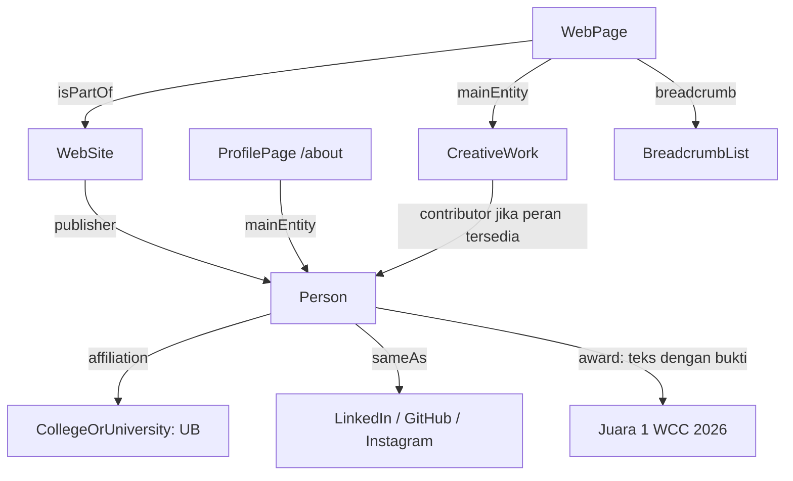

# Phase 4 — Entity architecture

Tanggal: 24 November 2026. Status: implementasi lokal; checkpoint Phase 3 telah deployed pada commit cd05aa6. Phase 4 belum dipush/deploy.

## Identitas dan bukti

Nama utama: Muhammad Ahmad Rofi’us Su’ud. Bentuk apostrof lurus tetap dikenali sebagai alternateName; Rofi’us Su’ud dan MARS digunakan di konten profil. Mahasiswa Pendidikan Teknologi Informasi FILKOM Universitas Brawijaya berdasarkan profil yang sudah tersedia dan instruksi pemilik. Affiliation tidak menyatakan hubungan kerja atau alumni.

Penghargaan Person.award dibatasi pada Juara 1 WCC UNISNU Jepara 2026. Sertifikat lokal `public/images/competitions/sertifikat-wcc-web-development.jpeg` diperiksa visual: nama pemilik, 1st Winner, WCC 2026 dan UNISNU Jepara. Pernyataan dan tautan bukti ditambahkan secara terlihat pada /about. Penghargaan lain tidak diperluas ke schema sebelum masalah tanggal/label pada SEO-14 dikonfirmasi.

## Stable identifiers

| Entitas | @id | Lokasi |
|---|---|---|
| Person | https://rofiporto.vercel.app/#person | Semua 36 halaman |
| WebSite | https://rofiporto.vercel.app/#website | Semua 36 halaman, termasuk beranda |
| CollegeOrUniversity | https://rofiporto.vercel.app/#universitas-brawijaya | Semua 36 halaman |
| ProfilePage | https://rofiporto.vercel.app/about#webpage | Hanya /about |
| WebPage | canonical URL + #webpage (beranda /#webpage) | Halaman lain |
| CreativeWork | canonical URL proyek + #work | Proyek kategori kerja/lomba |
| BreadcrumbList | canonical URL + #breadcrumb | Semua halaman selain beranda |

Satu script JSON-LD @graph per dokumen, ID unik dalam dokumen. Pengulangan entitas lintas URL memakai ID yang sama, bukan membuat pemilik baru. Referensi mainEntityOfPage Person menunjuk profil canonical.

## Pilihan schema

- Person, WebSite, CollegeOrUniversity dan CreativeWork menjelaskan entitas secara semantik; validitas semantik tidak menjanjikan rich result.
- ProfilePage hanya pada halaman yang topik utamanya profil pemilik. Beranda menggunakan WebPage. Eligibility Google tetap tergantung pedoman dan evaluasi Google.
- BreadcrumbList sesuai navigasi terlihat dan canonical. Google dapat memilih menampilkannya atau tidak.
- CreativeWork tidak menyatakan pemilik sebagai pencipta tunggal. contributor hanya ketika metadata peran tersedia. Tidak ditambahkan rating, harga, pengguna, atau tanggal buatan.
- SoftwareApplication ditunda: kematangan aplikasi/prototipe dan informasi eligibility belum terverifikasi. Article/BlogPosting ditunda karena belum ada artikel publikasi yang dibuktikan. Finalis paper PHIC bukan bukti publikasi jurnal.
- Publikasi tidak dimasukkan sebagai entitas tanpa URL/DOI dan data penulis yang benar. Tidak ada halaman palsu untuk variasi nama.

Implementasi: `src/lib/structured-data.ts`, `src/components/structured-data.tsx`, semua template route. Serialisasi meng-escape karakter `<` agar isi data tidak menutup elemen script.

## Acuan

[Person](https://schema.org/Person), [CreativeWork](https://schema.org/CreativeWork), [SoftwareApplication](https://schema.org/SoftwareApplication), [Google ProfilePage](https://developers.google.com/search/docs/appearance/structured-data/profile-page), [Google breadcrumb](https://developers.google.com/search/docs/appearance/structured-data/breadcrumb).
